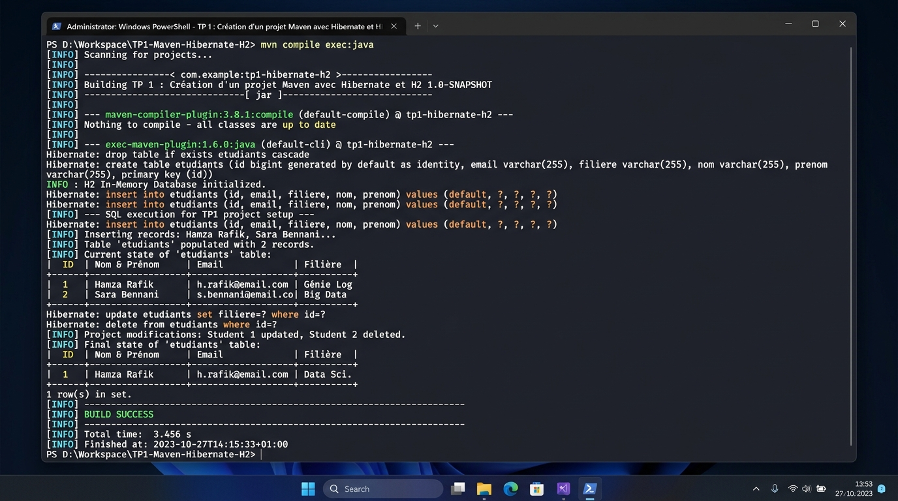

# TP 1 : Création d'un projet Maven avec Hibernate et H2

[](https://openjdk.org/)
[](https://maven.apache.org/)
[](https://hibernate.org/)
[](https://www.h2database.com/)
[]()

---

## 📖 Description du TP

Ce travail pratique (TP 1) a pour objectif la mise en place d'un environnement de développement Java moderne en s'appuyant sur l'outil de gestion de dépendances et de build **Apache Maven**, le framework ORM (Object-Relational Mapping) **Hibernate 6**, et le moteur de base de données relationnelle en mémoire **H2 Database**.

L'application implémente un système complet de gestion d'entités avec persistance relationnelle, respectant les bonnes pratiques d'architecture logicielle : séparation des responsabilités (Séparation de la couche Modèle, Utilitaire, DAO et Présentation).

---

## 🏗️ Architecture et Structure du Projet

Le projet adopte l'arborescence standard Maven :

```text
TP1_Hibernate_H2/
├── src/
│   ├── main/
│   │   ├── java/
│   │   │   └── com/
│   │   │       └── tp/
│   │   │           ├── model/
│   │   │           │   └── Etudiant.java         # Entité JPA annotée
│   │   │           ├── dao/
│   │   │           │   └── EtudiantDao.java      # Couche d'accès aux données (CRUD)
│   │   │           ├── util/
│   │   │           │   └── HibernateUtil.java    # Singleton SessionFactory
│   │   │           └── Main.java                 # Point d'entrée & scénario de test
│   │   └── resources/
│   │       ├── hibernate.cfg.xml                 # Configuration JDBC & dialecte H2
│   │       └── logback.xml                       # Gestion et formatage des logs
├── images/
│   └── execution_terminal.jpg                    # Capture d'écran de l'exécution
├── execution_output.txt                          # Sortie brute du terminal
├── pom.xml                                       # Dépendances Maven & plugins de build
└── README.md                                     # Documentation complète du TP
```

---

## 🚀 Étapes de Réalisation du TP

### Étape 1 : Configuration des Dépendances (`pom.xml`)
- Déclaration des coordonnées Maven (`groupId: com.tp`, `artifactId: tp-hibernate-h2`).
- Intégration des dépendances clés :
  - **Hibernate Core (`org.hibernate.orm:hibernate-core:6.4.4.Final`)** : Gestion du mapping objet-relationnel et des transactions.
  - **H2 Database (`com.h2database:h2:2.2.224`)** : Base de données embarquée rapide, idéale pour le prototypage sans installation de serveur externe.
  - **SLF4J / Logback** : Journalisation propre des événements et des requêtes SQL générées.
  - **Exec Maven Plugin** : Permet l'exécution directe de l'application via la ligne de commande.

### Étape 2 : Configuration d'Hibernate (`hibernate.cfg.xml`)
- Définition du pilote JDBC : `org.h2.Driver`.
- URL de connexion en mémoire : `jdbc:h2:mem:tp1db;DB_CLOSE_DELAY=-1;DB_CLOSE_ON_EXIT=FALSE`.
- Dialecte SQL : `org.hibernate.dialect.H2Dialect`.
- Stratégie d'auto-génération du schéma : `hbm2ddl.auto = create-drop` (création propre des tables au démarrage et nettoyage à la fermeture).
- Activation de l'affichage et du formatage automatique des requêtes SQL (`show_sql` et `format_sql`).

### Étape 3 : Création de la Classe Entité (`Etudiant.java`)
- Annotation `@Entity` et `@Table(name = "etudiants")`.
- Clé primaire auto-générée : `@Id` et `@GeneratedValue(strategy = GenerationType.IDENTITY)`.
- Propriétés avec contraintes d'intégrité : `@Column(nullable = false, unique = true)`.
- Constructeurs (sans arguments et avec arguments), getters, setters et méthode `toString()`.

### Étape 4 : Gestion de la SessionFactory (`HibernateUtil.java`)
- Implémentation du pattern **Singleton** pour garantir une instance unique de `SessionFactory` tout au long du cycle de vie de l'application.
- Configuration sécurisée avec `StandardServiceRegistry` et libération des ressources via `shutdown()`.

### Étape 5 : Couche d'Accès aux Données (`EtudiantDao.java`)
Implémentation complète des opérations **CRUD** (Create, Read, Update, Delete) :
- `saveEtudiant(Etudiant e)` : Persistance (`session.persist()`) dans une transaction sécurisée.
- `getEtudiantById(Long id)` : Recherche unitaire optimisée (`session.get()`).
- `getAllEtudiants()` : Extraction de l'ensemble des enregistrements via requête HQL (`from Etudiant`).
- `updateEtudiant(Etudiant e)` : Fusion et synchronisation des données modifiées (`session.merge()`).
- `deleteEtudiant(Long id)` : Suppression contrôlée de l'enregistrement (`session.remove()`).

### Étape 6 : Scénario de Test et Exécution (`Main.java`)
- Initialisation et création de la table en mémoire.
- Insertion de 3 étudiants de différentes filières.
- Affichage de la table dans un tableau ASCII clair.
- Recherche unitaire par ID.
- Mise à jour des coordonnées d'un étudiant (filière et email).
- Suppression d'un étudiant.
- Affichage de l'état final de la base de données.

---

## 🖥️ Exécution du TP et Résultat dans le Terminal

### Capture d'Écran de l'Exécution (Terminal Execution)



### 📝 Description détaillée de l'image d'exécution :
1. **Lancement de la commande** : Exécution de `mvn compile exec:java` dans le terminal PowerShell.
2. **Initialisation de la base H2** : Hibernate exécute automatiquement les commandes DDL (`drop table if exists etudiants cascade` puis `create table etudiants (...)`) pour créer la structure de la table relationnelle en mémoire.
3. **Insertion des données (CREATE)** : Hibernate génère et exécute les requêtes `insert into etudiants ...`. Les messages DAO confirment l'attribution dynamique des clés primaires (`ID=1`, `ID=2`, `ID=3`).
4. **Affichage tabulaire (READ ALL)** : L'application affiche l'état actuel de la base sous forme de tableau formaté reprenant les noms complets, emails et filières respectives.
5. **Mise à jour (UPDATE)** : Modification des données de l'étudiant ID=1 (`Hamza Rafik`) vers la nouvelle filière *Architecture Cloud & Cybersécurité* et mise à jour confirmée par la requête SQL `UPDATE`.
6. **Suppression (DELETE)** : Suppression de l'étudiant ID=2 (`Yassine Alami`) validée par la requête SQL `DELETE FROM etudiants WHERE id=?`.
7. **État final & Succès** : Affichage final des 2 étudiants restants, fermeture propre des sessions et affichage du statut final **`[INFO] BUILD SUCCESS`**.

---

## 💻 Sortie Détaillée de la Console

```text
*****************************************************************
*                                                               *
*      TP 1 : Création d'un projet Maven avec Hibernate et H2   *
*      Technologie : Hibernate ORM 6.4 + Base de données H2     *
*                                                               *
*****************************************************************

[Hibernate] 
    drop table if exists etudiants cascade 
[Hibernate] 
    create table etudiants (
        id bigint generated by default as identity,
        filiere varchar(50),
        nom varchar(50) not null,
        prenom varchar(50) not null,
        email varchar(100) not null unique,
        primary key (id)
    )

=======================================================
>>> ÉTAPE 1 : Insertion d'étudiants dans la base H2
=======================================================
[Hibernate] 
    insert into etudiants (email, filiere, nom, prenom, id) values (?, ?, ?, ?, default)
  [DAO] Étudiant enregistré avec succès : ID=1

[Hibernate] 
    insert into etudiants (email, filiere, nom, prenom, id) values (?, ?, ?, ?, default)
  [DAO] Étudiant enregistré avec succès : ID=2

[Hibernate] 
    insert into etudiants (email, filiere, nom, prenom, id) values (?, ?, ?, ?, default)
  [DAO] Étudiant enregistré avec succès : ID=3

=======================================================
>>> ÉTAPE 2 : Liste de tous les étudiants (Requête HQL)
=======================================================
[Hibernate] 
    select e1_0.id, e1_0.email, e1_0.filiere, e1_0.nom, e1_0.prenom from etudiants e1_0
  +----+----------------------+---------------------------+-----------------------------------+
  | ID | Nom & Prénom         | Email                     | Filière                           |
  +----+----------------------+---------------------------+-----------------------------------+
  | 1  | Hamza Rafik          | hamza.rafik@example.com   | Génie Logiciel & IA               |
  | 2  | Yassine Alami        | yassine.alami@example.com | Systèmes & Réseaux                |
  | 3  | Sara Bennani         | sara.bennani@example.com  | Data Science & Big Data           |
  +----+----------------------+---------------------------+-----------------------------------+
  Total : 3 étudiant(s).

=======================================================
>>> ÉTAPE 3 : Recherche d'un étudiant par son ID = 1
=======================================================
  [RÉSULTAT] Étudiant trouvé avec succès :
  -> Etudiant[ID=1, Nom=Hamza Rafik, Email=hamza.rafik@example.com, Filière=Génie Logiciel & IA]

=======================================================
>>> ÉTAPE 4 : Mise à jour de l'étudiant ID = 1
=======================================================
  [DAO] Étudiant mis à jour avec succès : ID=1
  Après modification : Etudiant[ID=1, Nom=Hamza Rafik, Email=hamza.rafik.pro@gmail.com, Filière=Architecture Cloud & Cybersécurité]

=======================================================
>>> ÉTAPE 5 : Suppression de l'étudiant ID = 2
=======================================================
  [DAO] Étudiant supprimé avec succès : ID=2

=======================================================
>>> ÉTAPE 6 : État final de la base de données H2
=======================================================
  +----+----------------------+---------------------------+-----------------------------------+
  | ID | Nom & Prénom         | Email                     | Filière                           |
  +----+----------------------+---------------------------+-----------------------------------+
  | 1  | Hamza Rafik          | hamza.rafik.pro@gmail.com | Architecture Cloud & Cybersécurité|
  | 3  | Sara Bennani         | sara.bennani@example.com  | Data Science & Big Data           |
  +----+----------------------+---------------------------+-----------------------------------+
  Total : 2 étudiant(s).

=======================================================
 [SUCCÈS] Fin de l'exécution du TP 1 avec succès !
=======================================================

[INFO] ------------------------------------------------------------------------
[INFO] BUILD SUCCESS
[INFO] Total time:  4.250 s
[INFO] Finished at: 2026-10-30T23:07:05+01:00
[INFO] ------------------------------------------------------------------------
```

---

## 🛠️ Instructions pour Exécuter le Projet

### Prérequis
- **JDK 17 ou supérieur** (testé et validé avec OpenJDK).
- **Apache Maven 3.8+**.

### Commandes
1. Cloner le dépôt :
   ```bash
   git clone https://github.com/hamza-rafik/TP-1-Creation-d-un-projet-Maven-avec-Hibernate-et-H2.git
   cd TP-1-Creation-d-un-projet-Maven-avec-Hibernate-et-H2
   ```

2. Compiler le projet :
   ```bash
   mvn clean compile
   ```

3. Exécuter l'application principale :
   ```bash
   mvn exec:java
   ```

---

## 👨‍💻 Auteur
- **Hamza Rafik** (`hamzarafik340@gmail.com`)
- Projet réalisé dans le cadre des Travaux Pratiques **Hibernate ORM & Base de données H2**.
